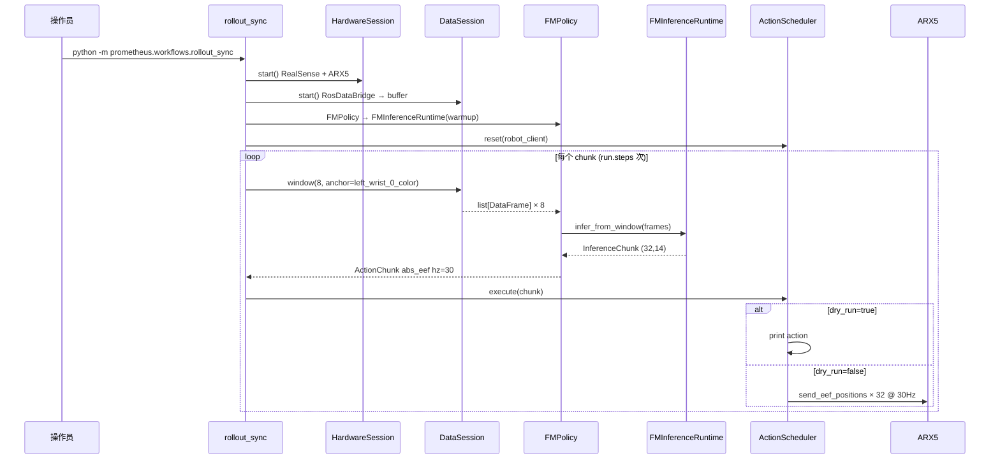
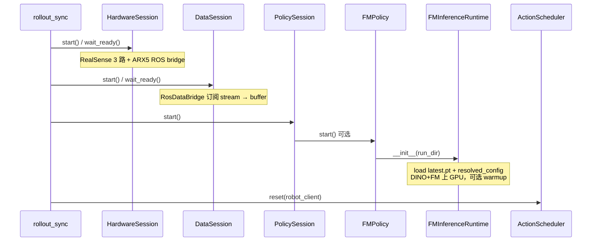
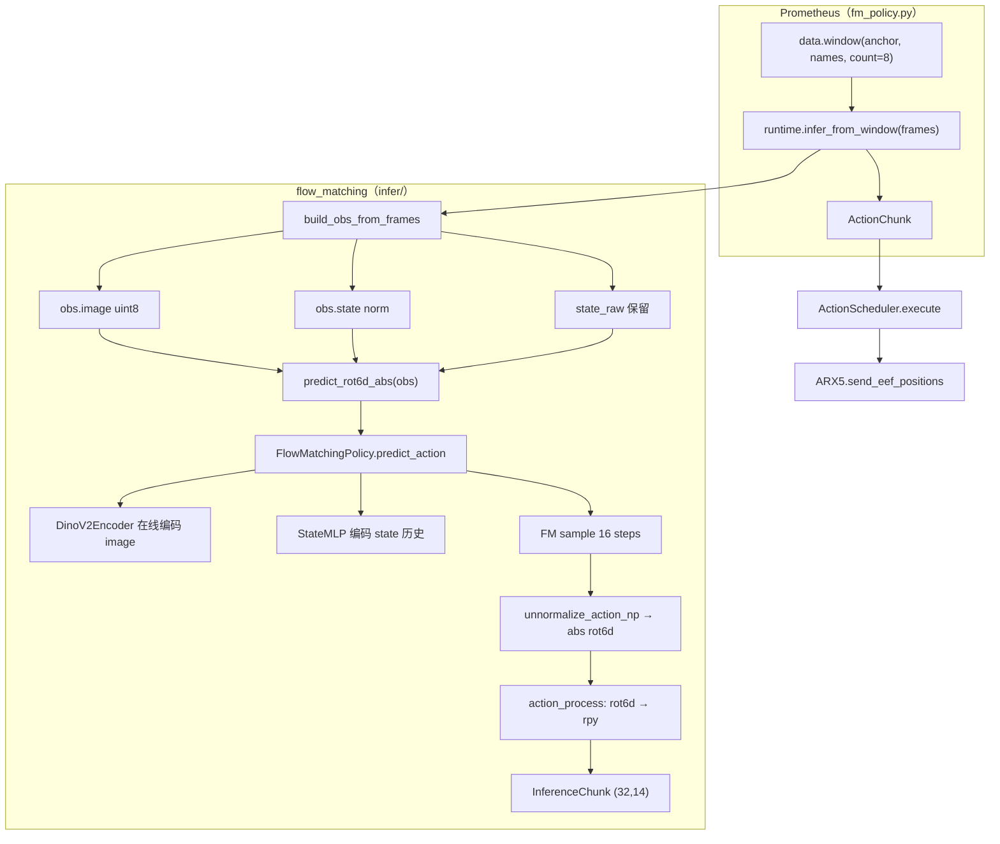

# Deploy Workload（PrometheusV3 + FM Policy）

> 框架：`deploy/PrometheusV2`（branch `dev/V3`）  
> 推理代码（git vendor）：`deploy/PrometheusV2/third_party/flow_matching`  
> 训练源（开发机）：`/mnt/workspace/zyj/policy`  
> 预处理参考：`/mnt/workspace/zyj/preprocess`  
> 参考 adapter（仅 stream 对齐思路）：`HumanEgoPolicy` — **不走 websocket / 单 d405 / stereo init**

---

## 当前进度（2026-07-01）

| 模块 | 状态 | 说明 |
|------|------|------|
| `third_party/flow_matching` | ✅ 已迁入 | 与 `policy/` 同构，git 管理；`.gitignore` 排除 `*.pt` |
| 部署产物 `chahua_eef_vision` | ✅ | `outputs/.../{latest.pt, resolved_config.yaml}`；**`deploy` 段已写入** |
| `infer/` 包 | ✅ | P0 迁入 + preprocess/postprocess；对外 API 见 `infer/__init__.py` |
| `inference_runtime.py` | ✅ shim | 薄 re-export，兼容旧 import |
| `infer/preprocess.py` | ✅ | `build_obs_from_frames`：ROS DataFrame → obs + state_raw |
| `infer/postprocess.py` | ✅ | `apply_action_process`：rot6d abs(20) → abs_eef rpy(14) |
| `infer/runtime.py` | ✅ | `predict_rot6d_abs` + **`infer_from_window` → `InferenceChunk`** |
| `tools/eval_deploy_open_loop.py` | ✅ | P0 验收 CLI；`from infer import ...` |
| P0 离线验收 | ✅ | `action_l1≈0.0057`，`infer_ms≈59ms` |
| P2+P3 smoke | ✅ | mock frames → `infer_from_window` → `(32,14)`；rpy 往返 <1e-4 |
| `fm_policy.py` | ✅ | `window()` + `runtime.infer_from_window()` → `ActionChunk` |
| Hydra：`policy/fm.yaml` | ✅ | stream / anchor / run_dir |
| Hydra：`robot/x5_x_fm.yaml` | ✅ | `abs_eef` + `hz:30` + 3 路相机 |
| Hydra：`rollout_fm_sync.yaml` | ✅ | `dry_run: true`，`steps: 1` |
| `tests/test_fm_policy.py` | ✅ | mock runtime，3 passed |
| dry_run rollout（真机/ROS） | ⏳ | 配置就绪；需硬件 + ROS stream 在线 |

---

## P0–P3 完成边界 & 下一步

### 已交付 API（`flow_matching/infer/`）

```text
# 低层（P0，仍可直接调用）
predict_rot6d_abs(obs, state_raw=...) → (32, 20) absolute eef rot6d

# 高层（P2+P3，真机 / fm_policy 入口）
infer_from_window(frames) → InferenceChunk
  actions: (32, 14) float32
  action_space: "abs_eef"
  hz: 30.0
```

**P2 preprocess**（`infer/preprocess.py`）：

```text
build_obs_from_frames(frames, PreprocessConfig, normalizer)
  obs.image   (1,1,3,3,224,224) uint8
  obs.state   (8,20) float32 normalized
  state_raw   (8,20) float32
```

**P3 postprocess**（`infer/postprocess.py`）：

```text
apply_action_process(rot6d_traj, "abs_eef") → (32, 14)
  eef_rot6d_abs_to_rpy_abs(arm20)  # 每臂 xyz(3)+rpy(3)+grip(1)
```

### 仍未完成

```text
fm_policy.py + fm.yaml + rollout_fm_sync.yaml   # P1
InferenceChunk → prometheus ActionChunk 转换    # P1（fm_policy 内一行）
dry_run rollout_sync                            # P1 验收
preprocess 与 zarr/录包数值对齐                  # 待补对比脚本
真机 dry_run=false                              # P4
```

### 目标端到端（P1 完成后）

```text
DataSession.window()
  → runtime.infer_from_window(frames)     # infer/ 已实现
  → fm_policy 转为 ActionChunk
  → scheduler.execute
```

### 实施顺序（更新）

| 步 | 阶段 | 状态 | 任务 | 产出 / 验收 |
|----|------|------|------|-------------|
| **0** | P0 | ✅ | `infer/` 核心 + `predict_rot6d_abs` + eval CLI | `action_l1≈0.0057` |
| **a** | 搬家 | ✅ | P0 迁入 `infer/`；`inference_runtime.py` shim | import 兼容 |
| **1** | P2 | ✅ | `build_obs_from_frames` | mock frames smoke ✓ |
| **2** | P3 | ✅ | `apply_action_process` + `infer_from_window` | `(32,14)` ✓ |
| **3** | P1 | ✅ | `fm_policy.py` + Hydra | 单元测试通过；真机 dry_run ⏳ |
| **4** | P4 | ❌ | 真机 | `dry_run=false` |

> **当前重点**：真机/ROS 上跑 `rollout_fm_sync`（`scheduler.dry_run=true`），验证 stream 对齐与 chunk 下发。

### 各步文件清单

```text
已完成  flow_matching/infer/
         ├── __init__.py          # 对外 API
         ├── config.py            # DeployConfig, load_run_config
         ├── runtime.py           # FMInferenceRuntime, infer_from_window
         ├── tensor.py            # numpy_obs_to_torch
         ├── preprocess.py        # build_obs_from_frames ✅
         ├── postprocess.py       # apply_action_process ✅
         ├── types.py             # InferenceChunk, PreprocessConfig ✅
         └── zarr_bridge.py       # obs_from_zarr_window（eval only）
         inference_runtime.py     # shim re-export

待做    真机 dry_run rollout 验收
        preprocess 与 zarr/录包数值对齐（可选）
```

### `infer/` 包（已实现）

#### 原则

| 原则 | 说明 |
|------|------|
| **位置** | 全部在 `flow_matching/infer/`，仍在 `third_party` git 内 |
| **不 import Prometheus** | `flow_matching` 不能依赖 `prometheus.*`（方向：Prometheus → flow_matching） |
| **输出类型** | `infer_from_window` 返回 **`InferenceChunk`**（本包 dataclass），`fm_policy` 再转成 `prometheus.policy.scheduler.ActionChunk` |
| **向后兼容** | 根目录 `inference_runtime.py` 保留为 **薄 re-export**，避免已有脚本立刻全改 import |

#### 目标目录

```text
flow_matching/
├── infer/
│   ├── __init__.py          # 对外 API（FMInferenceRuntime, infer_from_window 等）
│   ├── config.py            # DeployConfig, load_run_config, action_dim_for_config
│   ├── runtime.py           # FMInferenceRuntime（load ckpt, predict_rot6d_abs）
│   ├── tensor.py            # numpy_obs_to_torch, image/state shape 规范化
│   ├── preprocess.py        # 步 1：ROS DataFrame → obs + state_raw
│   ├── postprocess.py       # 步 2：rot6d abs(20) → abs_eef rpy(14)
│   ├── types.py             # InferenceChunk, PreprocessConfig
│   └── zarr_bridge.py       # obs_from_zarr_window（仅 eval，非真机路径）
├── inference_runtime.py     # shim: from infer import *  （兼容 P0 脚本）
└── tools/
    └── eval_deploy_open_loop.py
```

#### 模块职责

| 文件 | 职责 | 状态 |
|------|------|------|
| `config.py` | 读 `resolved_config` + `deploy` 段 | ✅ |
| `runtime.py` | `FMInferenceRuntime`、`predict_rot6d_abs`、`infer_from_window` | ✅ |
| `preprocess.py` | `build_obs_from_frames(frames, cfg)` | ✅ |
| `postprocess.py` | `eef_rot6d_abs_to_rpy_abs`, `apply_action_process` | ✅ |
| `types.py` | `InferenceChunk`, `PreprocessConfig` | ✅ |
| `tensor.py` | obs shape 规范化、torch 转换 | ✅ |
| `zarr_bridge.py` | P0 验收用 zarr 模拟 obs | ✅ |

#### 数据流（步 1+2 完成后）

```text
infer_from_window(frames)
  │
  ├─ preprocess.build_obs_from_frames(frames, preprocess_cfg, normalizer)
  │     ├─ 每帧: PoseStamped + JointState → rot6d state_raw (8,20)
  │     ├─ anchor 帧: 3×RGB → resize 224 → image (1,1,3,3,224,224)
  │     └─ state_norm = normalizer.normalize_state_np(state_raw)
  │
  ├─ runtime.predict_rot6d_abs(obs, state_raw) → (32, 20)
  │
  └─ postprocess.apply_action_process(rot6d, deploy.action_process)
        └─ InferenceChunk(actions=(32,14), action_space="abs_eef", hz=30)
```

#### 关键类型

```python
# infer/types.py
@dataclass(frozen=True)
class PreprocessConfig:
    camera_views: tuple[str, ...]      # base_0_color, left_wrist_0_color, ...
    gripper_names: dict[str, str]      # left/right → joint name
    image_size: int = 224
    gripper_width_m: float = 0.082

@dataclass(frozen=True)
class InferenceChunk:
    actions: np.ndarray                # (T, D)  e.g. (32, 14)
    action_space: str                  # "abs_eef"
    hz: float
    metadata: dict = field(default_factory=dict)
```

```python
# fm_policy.py（步 3，仅转换，不写 preprocess 逻辑）
from prometheus.policy.scheduler import ActionChunk

chunk = self.runtime.infer_from_window(frames)
return ActionChunk(chunk.actions, chunk.action_space, chunk.hz, chunk.metadata)
```

#### `preprocess.py` 函数清单（步 1）

| 函数 | 输入 | 输出 |
|------|------|------|
| `ros_image_to_rgb(msg)` | `sensor_msgs/Image` | `H×W×3` uint8 RGB |
| `quat_wxyz_to_rot6d(q)` | `(4,)` | `(6,)` — 对齐 preprocess |
| `build_arm_eef10(pose_msg, gripper_m)` | PoseStamped + float | `(10,)` |
| `build_state_frame(frame, cfg)` | 单帧 DataFrame | `(20,)` |
| `build_obs_from_frames(frames, cfg, normalizer)` | `list[DataFrame]` | `(obs, state_raw)` |

参考：`preprocess/pipeline/process.py::build_eef9p1`、`humanego_policy` 的 image/gripper 读取。

#### `postprocess.py` 函数清单（步 2）

| 函数 | 说明 |
|------|------|
| `rot6d_to_rpy(rot6d6)` | 6D rotation → roll,pitch,yaw（对齐 ARX5 `rpy_to_quaternion_wxyz` 逆） |
| `eef_rot6d_abs_to_rpy_abs(arm20)` | 单臂 10 → 7 |
| `apply_action_process(traj20, process)` | `(32,20)` → `(32,14)` 当 `process=="abs_eef"` |

#### 迁移 PR 状态

| PR | 内容 | 状态 |
|----|------|------|
| **PR-a** | 建 `infer/`，P0 迁入；shim + eval 改 import | ✅ |
| **PR-b+c** | `preprocess.py` + `postprocess.py` + `infer_from_window` | ✅ |
| **PR-d** | `fm_policy` + Hydra（步 3） | ✅ |

#### 验收（步 1+2）

| 项 | 状态 | 方法 |
|----|------|------|
| postprocess shape | ✅ | `infer_from_window` → `actions.shape == (32, 14)` |
| rpy 约定 (O1) | ✅ | `rotation_matrix_to_rpy` 与 `rpy_to_quaternion_wxyz` 往返 <1e-4 |
| mock 端到端 smoke | ✅ | mock `list[DataFrame]` 无异常 |
| P0 回归 | ✅ | `eval_deploy_open_loop.py` 指标不退化 |
| preprocess 对齐 | ⏳ | zarr/录包 vs `build_obs_from_frames` 同 window |
| dry_run rollout | ❌ | 依赖 P1 |

---

| ID | 项 | 状态 | 说明 |
|----|-----|------|------|
| O1 | rot6d→rpy 欧拉约定 | ✅ | `infer/postprocess.py`；对齐 ARX5 `rpy_to_quaternion_wxyz` 逆 |
| O2 | gripper 标定 | ⏳ | 当前用 `gripper_opening_m`（JointState 米制）；待与 preprocess zarr `joint[6]` 数值对比 |
| O4 | checkpoint 含 tactile 分支 | ✅ | vision-only 零触觉；ckpt 架构仍可能含 tactile 分支 |

---

## 已确认决策

| 项 | 决策 | 说明 |
|----|------|------|
| **代码托管** | `third_party/flow_matching` git 统一管理 | 训练在 `/mnt/workspace/zyj/policy`；部署机只 vendor + 产物 |
| **部署产物** | 每 task 传 `latest.pt` + `resolved_config.yaml` | 放 `flow_matching/outputs/<task>/`；checkpoint 不进 git |
| **触觉 / 纯视觉** | **P0 纯视觉，不读 tactile stream** | 真机尚无 tactile node；`obs` 仅 `image` + `state` |
| **推理位置** | **同机 4090，in-process（方案 B）** | `fm_policy` 直接 import `flow_matching`；不用 websocket |
| **执行节奏** | **保持 `rollout_sync` 同步** | 每次 `infer()` → `scheduler.execute(chunk)` 完整 horizon |
| **机器人下发** | **`resolved_config.deploy.action_process`** | rot6d abs(20) → `abs_eef` 或 `abs_qpos`；`chahua_eef_vision` 默认 `abs_eef` |
| **与 HumanEgo 差异** | 本地 3 相机 + 8 帧 state 窗 + 无 stereo init | 不仿 remote server payload |
| **Prometheus policy 目录** | **仅新增 `fm_policy.py`** | 不在 `prometheus/policy/` 下再加 adapter 等文件；ROS↔rot6d、rot6d↔rpy 放 `flow_matching` |

---

## 运行时路径

```text
rollout_sync workflow
  -> DataSession.window()              # 8 帧时间对齐窗，anchor=left_wrist_0_color
  -> fm_policy.infer(data)             # prometheus/policy/fm_policy.py ✅
  -> infer.FMInferenceRuntime.infer_from_window(frames)   # ✅ 已实现
  -> InferenceChunk → ActionChunk
  -> ActionScheduler
  -> RobotControlClient (ARX5 cartesian)
```

---

## 目录规划

```text
deploy/
├── workload.md
└── PrometheusV2/
    ├── third_party/
    │   └── flow_matching/                 # git：训练代码 vendor 副本
    │       ├── infer/                     # ✅ 推理包（preprocess / postprocess / runtime）
    │       ├── inference_runtime.py       # shim re-export
    │       ├── outputs/
    │       │   └── chahua_eef_vision/
    │       │       ├── checkpoints/latest.pt
    │       │       ├── resolved_config.yaml   # deploy 段已写入
    │       │       └── deploy_validation/metrics.json
    │       ├── tools/                     # normalizer, robot_action, eval_deploy_open_loop
    │       └── models/fm/                 # FlowMatchingPolicy + DINO
    │
    └── prometheus/
        ├── policy/
        │   └── fm_policy.py               # ✅ 薄 adapter，调 infer runtime
        └── configs/
            ├── policy/fm.yaml             # ✅
            ├── robot/x5_x_fm.yaml         # ✅ abs_eef + 3 相机
            └── rollout_fm_sync.yaml       # ✅

/mnt/workspace/zyj/policy/                 # 训练源（开发机）
/mnt/workspace/zyj/preprocess/           # state/action 格式参考（build_eef9p1）
```

### 模块边界（对齐 `PrometheusV2/docs/POLICY.md`）

| 模块 | 职责 | 不做 |
|------|------|------|
| **DataSession** | stream 订阅、buffer、`frame()` / `window()` 时间对齐 | 模型预处理 |
| **fm_policy.py** | 读 Hydra stream 名、取 `DataSession` 窗、调 `runtime.infer_from_window`、返回 `ActionChunk` | robot send、模型加载、格式转换实现 |
| **`infer/`** | ckpt、normalizer、`predict_action`、ROS↔rot6d、rot6d↔rpy 后处理 | 硬件控制 |
| **ActionScheduler** | 验证、滤波、定时下发 | 推理逻辑 |

---

## 部署模型（P0）

首选 task：**`chahua_eef_vision`**

| 配置项 | 值 | 备注 |
|--------|-----|------|
| `data.action_type` | eef | |
| `data.action_representation` | relative | unnormalize 时转 absolute rot6d |
| `data.use_tactile` | **false** | 与模型一致；**推理路径不订阅 tactile stream** |
| `models.fm.use_tactile` | **false** | 建模型时读 `models.fm`（`chahua_eef_vision` 纯视觉） |
| `deploy.action_process` | **`abs_eef`**（已写入 resolved_config） | 下发接口；由 `infer/postprocess.py` 转换 |
| `deploy.action_hz` | **30.0** | 与训练 30Hz 对齐 |
| `data.window_size` | 8 | state 历史长度 |
| `models.fm.action_horizon` | 32 | |
| `models.fm.num_inference_steps` | 16 | |
| `data.use_camera_latent` | true（**仅训练**） | **部署不用 latent**；实时 `obs.image` uint8 → 在线 DINO |

---

## 训练 vs 部署 vs P0 验收（必读）

```text
                    训练                    部署（真机 / rollout）           P0 离线验收
                    ────                    ─────────────────────           ────────────
数据来源            zarr replay_buffer      DataSession 实时 ROS stream    zarr（仅当测试替身）
视觉输入            image_backbone_feat     obs.image uint8 → 在线 DINO     同部署（在线 DINO）
                    （policy_latent_cache）  不用 camera_latent
触觉                可选                    P0 纯视觉，无 tactile           无
输出                loss / eval 指标        ActionChunk → 机器人            abs rot6d + 与 GT 比
```

**结论**：

1. **部署推理没有 zarr**。`fm_policy.infer(data)` 从 `DataSession.window()` 取实时相机 + state，交给 `infer.FMInferenceRuntime`；zarr 只出现在 **P0 验收脚本**里，用来在没有真机时模拟「实时 obs」并对比 GT。
2. **部署不用 `camera_latent`**。训练时 `use_camera_latent: true` 是为加速训练；真机每次 `infer()` 用 3 路 RGB resize 后走 `DinoV2Encoder`（backbone 与 checkpoint 一致，freeze）。不读 `policy_latent_cache.zarr`。

部署时 `infer` 的 obs 契约（与训练 batch 一致，但视觉走 image 分支）：

```text
obs.image  (1, 1, 3, 3, 224, 224)  uint8   # 实时 3 相机，anchor 单帧
obs.state  (1, 8, 20)              float32 # 8 帧 rot6d 历史，已 normalize
# 无 obs.tactile、无 obs.image_backbone_feat
```

---

## 真机推理工作流（rollout_fm_sync）

> **端到端路径**：ROS 6 路 stream → `DataSession.window(8)` → `FMPolicy.infer` → `infer.infer_from_window` → `ActionChunk(32,14)` → `ActionScheduler.execute` → ARX5。  
> P0 离线验收复用同一 `infer/` runtime，仅数据来源换成 zarr。

### 前置条件

| 项 | 要求 |
|----|------|
| **机器** | 4090 同机 in-process 推理（无 websocket） |
| **模型产物** | `third_party/flow_matching/outputs/chahua_eef_vision/{latest.pt, resolved_config.yaml}` |
| **机器人** | ARX5 x5_2，`x5_x_fm.yaml`：`action_space: abs_eef`，`hz: 30` |
| **ROS stream** | 6 路在线，`data.history≥32` |
| **action 对齐** | `resolved_config.deploy.action_process=abs_eef` ↔ `robot.action_space=abs_eef` |

**必需 stream**（anchor = `left_wrist_0_color`）：

| Stream | ROS 类型 | 频率 | 用途 |
|--------|----------|------|------|
| `base_0_color` | `sensor_msgs/Image` | ~30Hz | 视角 1 |
| `left_wrist_0_color` | Image | ~30Hz | **anchor 主时钟** |
| `right_wrist_0_color` | Image | ~30Hz | 视角 3 |
| `left_eef` / `right_eef` | `geometry_msgs/PoseStamped` | ~30Hz | xyz + quat |
| `robot_state` | `sensor_msgs/JointState` | ~120Hz | `left_gripper` / `right_gripper` |

### 入口命令

```bash
cd deploy/PrometheusV2

# ① 首次：dry_run（infer 正常，scheduler 只 print，不下发）
python -m prometheus.workflows.rollout_sync \
  --config-path prometheus/configs \
  --config-name rollout_fm_sync

# ② 真机下发：prometheus/configs/rollout_fm_sync.yaml
#    scheduler.dry_run: false
```

Hydra 组合：`rollout_fm_sync.yaml` → `robot: x5_x_fm` + `policy: fm` + `task: default` + `scheduler`。

**推荐步骤**：dry_run 验证 stream 对齐 + infer 无报错 → 改 `dry_run: false` 小步试动。

### 端到端时序（真机）



### dry_run vs 真机下发

| 模式 | 配置 | 行为 |
|------|------|------|
| **dry_run** | `scheduler.dry_run: true`（当前默认） | `FMPolicy.infer` 正常；`ActionScheduler` 只打印动作，**不调用** `robot_client.send_action` |
| **真机** | `scheduler.dry_run: false` | 每步 `ARX5.send_eef_positions(14,)`，cartesian `abs_eef` |

### 产物与日志

```text
outputs/rollout_fm_sync/default/<run_id>/
  workflow_manifest.json    # status, chunks, actions_sent, policy/robot 状态
  runtime/                  # 硬件 runtime 目录
```

`workflow_manifest.json` 关键字段：`chunks`、`actions_sent`（dry_run 时也为 32）、`scheduler.dry_run`、`policy` status（checkpoint、device）。

---

### 阶段 A：启动（一次性）



| 步骤 | 组件 | 动作 |
|------|------|------|
| A1 | `HardwareSession` | 启动相机节点、机器人 driver、`RobotControlClient` |
| A2 | `DataSession` | `RosDataBridge` 订阅 stream，写入 ring buffer（`history≥32`） |
| A3 | `FMPolicy` / `FMInferenceRuntime` | 读 `outputs/chahua_eef_vision/`，加载 ckpt + normalizer + 模型上 CUDA |
| A4 | `ActionScheduler` | 绑定 `robot_client`，`action_space` 与 `x5_x_fm` 一致 |

**Runtime 启动时读入**（`resolved_config.yaml` + `latest.pt`）：

```yaml
# 模型结构
models.fm.use_tactile: false
models.fm.action_horizon: 32
models.fm.num_inference_steps: 16
data.window_size: 8

# 部署下发（已写入 resolved_config）
deploy:
  action_process: abs_eef
  action_hz: 30.0
```

**不加载**：`policy_latent_cache.zarr`、`replay_buffer.zarr`、tactile stream。

---

### 阶段 B：同步推理循环（每个 chunk 重复）

```text
while chunks < run.steps:
    robot_client.spin_once(0)
    chunk = policy.infer(data_session)      # ← 一次推理
    scheduler.execute(chunk)                  # 30Hz × 32 步 ≈ 1.07s
    chunks += 1
```

单次 `infer()` 内部调用链：



---

### 阶段 B 逐步数据流（shape / dtype）

#### B1. 取实时窗 — `DataSession.window()`

**调用方**：`fm_policy.infer(data)`

```python
frames = data.window(
    anchor="left_wrist_0_color",
    names=[
        "base_0_color", "left_wrist_0_color", "right_wrist_0_color",
        "robot_state", "left_eef", "right_eef",
    ],
    count=8,
    stride=1,
    slop_ms=100.0,
)
# frames: list[DataFrame], len=8，按 anchor 时间对齐
```

| Stream | ROS 类型 | 频率 | 用途 |
|--------|----------|------|------|
| `base_0_color` | `sensor_msgs/Image` | ~30Hz | 视角 1 |
| `left_wrist_0_color` | Image | ~30Hz | 视角 2，**anchor 主时钟** |
| `right_wrist_0_color` | Image | ~30Hz | 视角 3 |
| `left_eef` / `right_eef` | `geometry_msgs/PoseStamped` | ~30Hz | xyz + quat |
| `robot_state` | `sensor_msgs/JointState` | ~120Hz | gripper joint |

---

#### B2. 组 obs — `infer.preprocess.build_obs_from_frames(frames)`

**输入**：`frames[0..7]`，每帧含上述 6 路 sample。  
**输出**：`obs` dict + `state_raw`（后处理 anchor）。

**State（8 帧历史）**：

```text
对 frames[i]（i=0..7）:
  left  = build_arm_eef10(left_eef PoseStamped, gripper_m)   # (10,) 对齐 build_eef9p1
  right = build_arm_eef10(right_eef, gripper_m)             # (10,)
  state_frame[i] = concat(left, right)                                   # (20,)

state_raw   = stack(state_frame)              # (8, 20) float32 未归一化
state_norm  = normalizer.normalize_state_np(state_raw)  # (8, 20)
```

**Image（anchor 单帧，3 视角）**：

```text
anchor = frames[-1]
对 view in [base_0_color, left_wrist_0_color, right_wrist_0_color]:
  rgb = ros_image_to_rgb(anchor.samples[view])     # uint8 H×W×3
  rgb = cv2.resize(rgb, (224,224), INTER_AREA)

stack views → (3, 3, 224, 224)
add dims    → image (1, 1, 3, 3, 224, 224) uint8
```

**组装 obs（模型输入）**：

```python
obs = {
    "image": image,           # (1, 1, 3, 3, 224, 224) uint8
    "state": state_norm,      # (8, 20) float32
}
state_raw  # (8, 20) 供 unnormalize 用，anchor = state_raw[-1]
```

| 字段 | Shape | Dtype | 说明 |
|------|-------|-------|------|
| `obs.image` | `(1,1,3,3,224,224)` | uint8 | **在线 DINO**，不用 latent |
| `obs.state` | `(8,20)` | float32 | 已 normalize |
| `state_raw` | `(8,20)` | float32 | 未 normalize，unnormalize 用 |

---

#### B3. 模型推理 — `FMInferenceRuntime.predict_rot6d_abs(obs)`

```python
obs_torch = {
    "image": torch.from_numpy(obs["image"]),   # → device, (1,1,3,3,224,224)
    "state": torch.from_numpy(obs["state"][None]),  # (1,8,20)
}
pred_norm = policy.predict_action(
    obs_torch,
    num_inference_steps=16,   # from resolved_config
    solver="euler",
)["action_pred_normalized"]     # (1, 32, 20)

pred_abs_rot6d = normalizer.unnormalize_action_np(
    pred_norm[0], state_raw
)                               # (32, 20) absolute eef rot6d
```

**模型内部（纯视觉）**：

```text
obs.image  → DinoV2Encoder (freeze)  → vis_feat (B, 256)
obs.state  → StateMLP (8 帧 flatten)  → state_feat (B, 256)
           → fusion → global_cond (B, 256)
           → ConditionalUnet1D flow matching, 16 steps
           → pred_norm (B, 32, 20)
```

无 `tactile` 分支；无 `image_backbone_feat`。

---

#### B4. 动作后处理 — `deploy.action_process`

`chahua_eef_vision` 默认 `abs_eef`：

```text
对 t in 0..31:
  arm20 = pred_abs_rot6d[t]              # (20,) rot6d abs
  arm14 = eef_rot6d_abs_to_rpy_abs(arm20)    # (14,) = left7 + right7
         # 每臂: xyz(3) + rpy(3) + grip(1)
```

```python
# infer/runtime.py — 已实现
chunk = runtime.infer_from_window(frames)   # InferenceChunk

# fm_policy.py — ✅ 已实现
from prometheus.policy.scheduler import ActionChunk
return ActionChunk(chunk.actions, chunk.action_space, chunk.hz, chunk.metadata)
```

---

#### B5. 执行 — `ActionScheduler.execute(chunk)`

```text
for i in 0..31:
    action_i = chunk.actions[i]            # (14,)
    filters.apply(action_i)                # 可选 EMA / max_delta
    robot_client.send_action("abs_eef", action_i)
    sleep(1/30)
```

ARX5 `send_eef_positions`：每臂 `xyz + rpy + gripper`，cartesian controller。

---

### 伪代码总览（一次 infer）

```python
# fm_policy.py — ✅ 已实现
from infer import FMInferenceRuntime
from prometheus.policy.scheduler import ActionChunk

class FMPolicy:
    def infer(self, data: DataSession) -> ActionChunk:
        frames = data.window(
            anchor=self.anchor,
            names=self.stream_names,
            count=self.window_size,
            stride=1,
            slop_ms=self.slop_ms,
        )
        chunk = self.runtime.infer_from_window(frames, robot=self.robot_cfg)
        return ActionChunk(chunk.actions, chunk.action_space, chunk.hz, chunk.metadata)

# infer/runtime.py（✅ 已实现）
class FMInferenceRuntime:
    def infer_from_window(self, frames, *, preprocess=None, robot=None) -> InferenceChunk:
        obs, state_raw = build_obs_from_frames(frames, preprocess_cfg, self.normalizer, ...)
        pred_rot6d = self.predict_rot6d_abs(obs, state_raw=state_raw)  # (32, 20)
        actions = apply_action_process(pred_rot6d, self.deploy.action_process)  # (32, 14)
        return InferenceChunk(actions, self.deploy.action_process, self.deploy.action_hz)
```

---

### 配置与代码映射

| 配置 | 路径 | 作用 |
|------|------|------|
| `rollout_fm_sync.yaml` | `prometheus/configs/` | workflow 入口、steps、dry_run |
| `policy/fm.yaml` | `prometheus/configs/policy/` | stream 名、anchor、`run_dir` |
| `robot/x5_x_fm.yaml` | `prometheus/configs/robot/` | 相机 SN、`action_space: abs_eef`、`hz:30` |
| `resolved_config.yaml` | `flow_matching/outputs/<task>/` | 模型结构、`deploy.*` |
| `latest.pt` | `.../checkpoints/` | 权重 + normalizer |

---

### P0 离线验收 vs 部署（同一 runtime）

| | 部署 | P0 验收 |
|---|------|---------|
| 触发 | `rollout_sync` 循环 | `eval_deploy_open_loop.py` |
| 数据来源 | `DataSession.window()` 实时 ROS | zarr 按 window_idx 拼帧（**模拟** B1–B2） |
| runtime API | `infer_from_window(frames)` | `predict_rot6d_abs(obs)` 或直接 `infer_from_window` |
| 视觉 | 在线 DINO，`obs.image` | **相同** |
| GT 对比 | 无 | zarr `get_action` 算 L1/MSE |
| 机器人 | `scheduler.execute` | 无 |

---

### 时序与资源

| 项 | 值 |
|----|-----|
| 单次 infer 动作时长 | 32 步 @ 30Hz ≈ **1.07s** |
| infer 计算 | DINO + 16-step FM（另计，首帧含模型 warmup） |
| GPU | 同机 4090，in-process，无 websocket |
| 同步策略 | 整 chunk 执行完再下一次 `infer()`（非 receding horizon） |
| 默认 `run.steps` | `1`（单次 infer + 单 chunk）；连续任务增大 `steps` |

**一句话**：真机推理 = ROS 6 路 → 8 帧窗 + 3 路图 → 本地 FM → `(32,14)` abs_eef → scheduler 30Hz 同步下发；默认 dry_run，改 `scheduler.dry_run: false` 进入真机控制。

---

## 数据流：DataSession → 模型 → ActionChunk

> 分步细节见 **「真机推理工作流（rollout_fm_sync）」**；本节保留字段级参考。

### 1. 取窗（对齐 preprocess master_clock）

preprocess 主时钟：`camera/left_wrist_0` → Prometheus anchor：`left_wrist_0_color`。

```python
frames = data.window(
    anchor="left_wrist_0_color",
    names=[
        "base_0_color",
        "left_wrist_0_color",
        "right_wrist_0_color",
        "robot_state",
        "left_eef",
        "right_eef",
    ],
    count=8,          # window_size
    stride=1,
    slop_ms=100.0,
)
```

`data.history >= 8`（建议 32，与 `rollout_humanego_sync` 一致）。

### 2. State：ROS → rot6d(20) → normalize

每帧 `DataFrame`（与 preprocess `build_eef9p1` 对齐）：

```text
left_arm  = xyz(3) from left_eef PoseStamped
          + rot6d(6) from quat_wxyz          # preprocess/pipeline/process.py
          + gripper(1) from robot_state.left_gripper joint position
right_arm = 同上（right_eef + right_gripper）
state_frame = concat(left_arm, right_arm)  # (20,) float32 raw
state_history = stack 8 frames             # (8, 20)
state_norm = normalizer.normalize_state_np(state_history)
```

参考实现：

- `preprocess/pipeline/process.py::build_eef9p1` / `quat_wxyz_to_rot6d`
- `humanego_policy.gripper_opening_m`（gripper joint 读取）
- `humanego_policy.pose_stamped_to_T`（可选校验；state 用 quat→rot6d 即可）

### 3. Image：anchor 单帧 3 视角 → uint8 tensor

对齐 `preprocess/pipeline/process.py` + `preprocess/export/layout.py`：

```text
anchor_frame = frames[-1]   # 与训练 n_image_steps=1 一致
views 顺序: [base_0_color, left_wrist_0_color, right_wrist_0_color]   # CAMERA_BUNDLE_ORDER
编码: ROS Image → RGB uint8（rgb8 直用；bgr8/bgra8 转 RGB，参考 humanego_policy 色彩处理）
resize: cv2.resize(224, 224, interpolation=cv2.INTER_AREA)   # preprocess camera.interpolation=area
obs.image = (1, 1, 3, 3, 224, 224) uint8   # batch, n_image_steps, views, C, H, W
```

训练 zarr 存的是 **RGB**（`layout.CAMERA_STREAM = "rgb"`）；部署须保证进 DINO 前为 RGB。  
训练用 latent cache；部署 **在线** `DinoV2Encoder.forward(image)`（backbone freeze）。

### 4. 推理 + 后处理（✅ 已实现）

```text
runtime.infer_from_window(frames)
  -> build_obs_from_frames (infer/preprocess.py)
  -> predict_rot6d_abs(obs, state_raw)
       build_flow_policy + load latest.pt
       policy.predict_action(obs, num_inference_steps=16)
       pred_norm (32, 20)
       normalizer.unnormalize_action_np(pred_norm, state_raw)   # relative→absolute
  -> apply_action_process (infer/postprocess.py)
       abs_eef  → eef_rot6d_abs_to_rpy_abs → (32, 14)
  -> InferenceChunk
  -> [P1] fm_policy 转为 prometheus ActionChunk
```

`unnormalize_action_np` 与 `eval_open_loop.py` / `vis_episode.py` 一致。  
ROS msg → rot6d、rot6d → 下发格式均在 **`infer/`**；`fm_policy` 只调 `runtime.infer_from_window(frames)` 并转为 Prometheus `ActionChunk`。

### 5. Action 空间对照

| 阶段 | 格式 | 维度 |
|------|------|------|
| 模型输出（runtime 内） | eef rot6d absolute | 20 |
| `deploy.action_process=abs_eef` | xyz+rpy+grip × 2 | 14 |
| `deploy.action_process=abs_qpos` | joint+grip × 2 | 14 |

`chahua_eef_vision` 为 eef 模型，P0–P4 默认 `abs_eef`。`abs_qpos` 分支预留给 joint checkpoint 或后续 IK。

真机 preset：`x5_x_fm.yaml`（`action_space` 须与 `deploy.action_process` 一致，当前 `abs_eef` + `hz:30`）。

### `resolved_config.yaml` 部署段（已写入）

`outputs/chahua_eef_vision/resolved_config.yaml` 末尾：

```yaml
deploy:
  action_process: abs_eef    # abs_eef | abs_qpos
  action_hz: 30.0
```

由 `infer/config.py` 的 `parse_deploy_config` 读取；`robot` Hydra preset 的 `action_space` 应与 `deploy.action_process` 一致。

---

## Hydra 配置示意

### `policy/fm.yaml`

```yaml
_target_: prometheus.policy.fm_policy.FMPolicy

inputs:
  anchor: left_wrist_0_color
  slop_ms: 100.0
  window_size: 8
  stride: 1
  stream_names:
    - base_0_color
    - left_wrist_0_color
    - right_wrist_0_color
    - robot_state
    - left_eef
    - right_eef
  camera_views: [base_0_color, left_wrist_0_color, right_wrist_0_color]
  gripper_names:
    left: left_gripper
    right: right_gripper

inference:
  run_dir: third_party/flow_matching/outputs/chahua_eef_vision
  device: cuda
  num_inference_steps: 16
  # action_process / action_hz 优先读 resolved_config.deploy
```

### `robot/x5_x_fm.yaml`（已存在）

基于 `x5_2.yaml`：`action_space: abs_eef`，`hz: 30`，相机 `base_0` / `left_wrist_0` / `right_wrist_0`。

### `rollout_fm_sync.yaml`（已存在）

```yaml
defaults:
  - robot: x5_x_fm
  - task: default
  - policy: fm
  - _self_

run:
  steps: 1                    # 单次 chunk；连续推理增大
  wait_ready_timeout_s: 5.0

scheduler:
  dry_run: true               # 真机下发改 false
```

---

## 实施阶段

| 阶段 | 内容 | 状态 | 验收 |
|------|------|------|------|
| **P0** | runtime 核心推理 + eval CLI | ✅ | obs → rot6d abs `(32,20)`；`action_l1≈0.0057` |
| **P2** | `build_obs_from_frames` | ✅ | mock frames；zarr 对齐 ⏳ |
| **P3** | `infer_from_window` → `InferenceChunk` | ✅ | `(32,14)` abs_eef |
| **P1** | `fm_policy` + Hydra + dry_run rollout | ✅ 代码 | 单元测试 ✓；真机 dry_run ⏳ |
| **P4** | 真机闭环 | ❌ | `dry_run=false` |

### P0 详细规划（历史参考，已完成）

> P2/P3 已在 `infer/` 实现。本节保留 P0 设计记录。

#### 目标

用 **zarr 仅作离线测试台**（模拟实时 obs + 提供 GT），跑通 `infer` 的 **部署形态**（在线 image，无 latent）：

1. checkpoint + normalizer 加载正确 ✅  
2. **在线 raw image → DINO → FM**（与真机相同，不用 camera_latent） ✅  
3. open-loop 指标与训练 eval 同量级 ✅  

> **zarr 不出现在真机路径**。P0 验收通过后，P1+ 改为 `DataSession` 实时传入相同结构的 `obs`。

P0 当时**不做**（现已由 P2/P3 完成）：ROS `DataFrame` preprocess、`rot6d→rpy`、`infer_from_window`。

#### 范围边界（P0 当时）

| P0 包含 | 后续阶段（现状态） |
|------|-------------------|
| `infer/` 核心 + shim | preprocess/postprocess ✅ |
| `tools/eval_deploy_open_loop.py` CLI | |
| `resolved_config.deploy` 段 | ✅ 已写入 |
| 从 zarr 模拟 obs（eval 脚本） | |
| 输出 abs rot6d `(32, 20)` | P3 输出 `(32,14)` ✅ |

#### 关键差异：训练 eval vs 部署 vs P0

| 路径 | 数据来源 | 视觉输入 |
|------|---------|---------|
| **训练 `eval_open_loop`** | zarr | `image_backbone_feat`（预计算 latent，**仅训练**） |
| **部署 / P0 主路径** | 实时 ROS / zarr 模拟 | `obs.image` uint8 → **在线 DINO**，**不用 camera_latent** |
| **P0 sanity（可选）** | zarr | latent baseline，核对 ckpt 是否与训练 eval 一致 |

`resolved_config` 里 `data.use_camera_latent: true` 是训练遗留字段；**runtime 推理始终走 `obs.image`**，不加载 `policy_latent_cache.zarr`。

#### 文件清单（当前）

```text
third_party/flow_matching/
├── infer/                        # 推理包（P0+P2+P3）
│   ├── preprocess.py
│   ├── postprocess.py
│   ├── runtime.py
│   └── ...
├── inference_runtime.py          # shim re-export
├── tools/
│   └── eval_deploy_open_loop.py  # P0 验收 CLI
└── outputs/chahua_eef_vision/
    ├── resolved_config.yaml      # deploy 段 ✅
    └── deploy_validation/metrics.json
```

#### `infer/` 模块设计（当前）

```text
infer/
├── config.py           load_run_config, DeployConfig, build_policy_from_cfg
├── tensor.py           numpy_obs_to_torch
├── preprocess.py       build_obs_from_frames, parse_preprocess_config
├── postprocess.py      apply_action_process, eef_rot6d_abs_to_rpy_abs
├── types.py            InferenceChunk, PreprocessConfig
├── zarr_bridge.py      obs_from_zarr_window（eval only）
└── runtime.py          FMInferenceRuntime
    ├── predict_rot6d_abs(...)
    └── infer_from_window(frames) -> InferenceChunk
inference_runtime.py    # shim: from infer import ...
```

```python
class FMInferenceRuntime:
    def __init__(
        self,
        run_dir: Path,
        *,
        checkpoint: Path | None = None,
        device: str | None = None,
    ): ...

    @property
    def normalizer(self) -> DatasetNormalizer: ...
    @property
    def window_size(self) -> int: ...
    @property
    def action_horizon(self) -> int: ...

    def predict_rot6d_abs(
        self,
        obs: Mapping[str, np.ndarray],
        *,
        state_raw: np.ndarray,
        num_inference_steps: int | None = None,
        solver: str | None = None,
    ) -> np.ndarray:
        """returns (horizon, 20) absolute rot6d float32"""

    def infer_from_window(
        self,
        frames: Sequence[Any],
        *,
        preprocess: PreprocessConfig | None = None,
        robot: Mapping[str, Any] | None = None,
    ) -> InferenceChunk:
        """returns InferenceChunk(actions=(32,14), action_space, hz)"""
```

**推荐 import**：

```python
from infer import FMInferenceRuntime, load_run_config, obs_from_zarr_window
# 或兼容：from inference_runtime import FMInferenceRuntime
```

**加载逻辑（必须与训练一致）**：

```python
fm_cfg = dict(cfg["models"]["fm"])
# 只读 models.fm，不用 data.use_tactile 覆盖
policy = build_flow_policy(
    {"models": {"fm": fm_cfg}},
    action_dim=20,
    state_dim=20,
    cond_steps=cfg["data"]["window_size"],
)
state = torch.load(checkpoint, ...)
policy.load_state_dict(state["policy_state_dict"])
normalizer = DatasetNormalizer.load_state_dict(state["normalizer_state_dict"])
```

**`obs` 契约（与 `ZarrDataset.__getitem__` 对齐，纯视觉）**：

```text
obs["state"]  float32  (8, 20)   # normalized；或 batch (B,8,20)
obs["image"]  uint8     (1, 1, 3, 3, 224, 224)   # batch, n_image_steps, views, C, H, W
# 不传 obs["tactile"]、obs["image_backbone_feat"]
```

转 torch 后加 batch 维：`(1, 8, 20)`、`(1, 1, 3, 3, 224, 224)`。

**后处理（P3，`infer/postprocess.py`）**：

```python
pred_abs = runtime.predict_rot6d_abs(obs, state_raw=state_raw)  # (32, 20)
actions = apply_action_process(pred_abs, deploy.action_process)  # (32, 14)
chunk = InferenceChunk(actions, deploy.action_process, deploy.action_hz)
```

#### `obs_from_zarr_window` 实现要点

从 zarr 构造 **在线 image** obs，不复用 dataset `__getitem__`（否则会走 latent）：

```python
def obs_from_zarr_window(dataset, window_idx):
    s0, s1 = dataset.state_range(window_idx)
    i0, i1 = dataset.image_range(window_idx)
    a0, a1 = dataset.action_range(window_idx)

    state_raw = dataset.get_state(s0, s1)                          # (8, 20)
    state_norm = dataset.normalizer.normalize_state_np(state_raw)
    camera = dataset.get_camera(i0, i1)                           # raw from zarr
    image = dataset._process_image(camera)                         # (1,3,3,224,224) uint8
    gt_abs = dataset.get_action(a0, a1)                            # (32, 20)

    obs = {
        "state": state_norm.astype(np.float32),
        "image": image.numpy() if torch.is_tensor(image) else image,
    }
    return obs, state_raw, gt_abs
```

#### `tools/eval_deploy_open_loop.py` 验收 CLI

```bash
cd third_party/flow_matching

python tools/eval_deploy_open_loop.py \
  --run-dir outputs/chahua_eef_vision \
  --max-batches 16 \
  --batch-size 16 \
  --seed 42 \
  --num-inference-steps 16 \
  --out-dir outputs/chahua_eef_vision/deploy_validation
```

**流程**：

```text
1. FMInferenceRuntime(run_dir)
2. ZarrDataset.from_config(data, fit_normalizer=False)   # 仅用于 window 索引 + GT
3. rng.choice(windows, max_batches * batch_size)           # 与 eval_open_loop 相同采样
4. 对每个 batch:
     obs_list = [obs_from_zarr_window(ds, idx) for idx in batch_indices]
     pred_abs = runtime.predict_rot6d_abs_batch(...)
     对比 gt_abs，累加 L1/MSE
5. 写 deploy_validation/metrics.json + 可选 plots/
```

**验收标准**：

| 指标 | 期望 |
|------|------|
| `action_l1` | 与训练 `eval_open_loop` 同 checkpoint 结果接近（建议 \|Δ\| < 5% 或绝对差 < 0.01，首跑记 baseline） |
| `action_mse` | 同上 |
| 可选 latent baseline | `image_backbone_feat` 路径应几乎贴 eval_open_loop（验证 ckpt） |
| 运行 | 无 NaN/inf；P0 shape `(32, 20)`；P3 `infer_from_window` shape `(32, 14)` |

**当前 baseline**（`deploy_validation/metrics.json`）：`action_l1≈0.0057`，`infer_ms≈59ms`。

若 online image 与 latent baseline 差距大：查 DINO 输入归一化、image `_process_image` shape、uint8 vs float。

#### 实施步骤（P0 已完成；P2/P3 已完成）

| Step | 任务 | 状态 |
|------|------|------|
| **0** | `resolved_config.yaml` 加 `deploy` 段 | ✅ |
| **1** | `load_run_config` + `build_policy_from_cfg` + checkpoint load | ✅ |
| **2** | `numpy_obs_to_torch` + `predict_rot6d_abs` | ✅ |
| **3** | `obs_from_zarr_window` + `eval_deploy_open_loop.py` | ✅ |
| **4** | `infer/` 搬家 + preprocess + postprocess + `infer_from_window` | ✅ |
| **5** | preprocess 与 zarr 数值对齐脚本 | ⏳ |
| **6** | `fm_policy` + Hydra + dry_run rollout | ❌ **下一步** |

#### 依赖与环境

```text
torch, timm, numpy, pyyaml, tqdm, zarr
数据: resolved_config.data.root_dir 指向的 replay_buffer.zarr（本机已有）
GPU: cuda（DINO + FM）；CPU 仅 smoke
```

`prometheus` 包 **P0 不依赖**；全在 `flow_matching` 内闭环。

#### P2/P3 接口（已实现）

```python
from infer import FMInferenceRuntime

runtime = FMInferenceRuntime("outputs/chahua_eef_vision")
chunk = runtime.infer_from_window(frames)  # InferenceChunk, actions (32, 14)
obs, state_raw = build_obs_from_frames(frames, preprocess_cfg, runtime.normalizer)
```

#### 风险与对策

| 风险 | 对策 |
|------|------|
| 在线 DINO 比 latent 慢 | P0 只验正确性；`eval_deploy_open_loop` 记录 `infer_ms` |
| `vis_episode` 仍用 `data.use_tactile` 覆盖 | P0 一并修正；runtime 不覆盖 |
| zarr 路径部署机不存在 | eval 脚本启动时检查 `data.root_dir`；文档写明仅 dev 机跑 P0 |
| 首帧 DINO 加载慢 | runtime `__init__` 可选 `warmup()` dummy forward |

---

### 实现要点（速查）

```python
# P0: predict_rot6d_abs(obs, state_raw) → (32, 20)
# P2: build_obs_from_frames(frames, PreprocessConfig, normalizer) → obs, state_raw
# P3: infer_from_window(frames) → InferenceChunk(actions=(32,14), ...)
# P1: fm_policy 转 ActionChunk + rollout dry_run
```

```python
from infer import FMInferenceRuntime

runtime = FMInferenceRuntime("outputs/chahua_eef_vision")
chunk = runtime.infer_from_window(frames)
pred = runtime.predict_rot6d_abs(obs, state_raw=state_raw)
```

---

## 开放项 / 验收点

| ID | 项 | 状态 | 说明 |
|----|-----|------|------|
| — | 纯视觉 P0 | ✅ | 不读 tactile stream；vision-only 零触觉 |
| — | `use_tactile` 配置 | ✅ | ckpt 架构可能含 tactile 分支；obs 不传 tactile |
| — | `deploy.action_process` | ✅ | 已写入 `resolved_config`；`infer/postprocess.py` 转换 |
| **O1** | rot6d → rpy 欧拉约定 | ✅ | `rotation_matrix_to_rpy` 与 ARX5 往返 <1e-4；真机录包验证 ⏳ |
| **O2** | Gripper 标定 | ⏳ | `gripper_opening_m` vs preprocess zarr `joint[6]` 数值对比待做 |
| **O3** | `deploy` 段写入产物 config | ✅ | `action_process` / `action_hz` 已在 resolved_config |
| **O4** | `abs_qpos` 下发路径 | 预留 | `apply_action_process` 对 abs_qpos 尚未实现 |

---

## 同步执行（当前不改）

```text
while chunks < run.steps:
    chunk = policy.infer(data_session)    # 32 步 action
    scheduler.execute(chunk)              # hz=30 逐步下发完整 chunk
    chunks += 1
```

- 一次 infer ≈ 32/30 ≈ **1.07s** 动作（另加 DINO+FM 推理延迟）
- 暂不使用 `scheduler.execute(steps=N)` receding horizon

---

## 产物同步（开发机 → 部署机）

```bash
# 示例：从训练机拷贝到 vendor outputs（或改 cp.sh）
rsync -avz policy/outputs/chahua_eef_vision/checkpoints/latest.pt \
  deploy/PrometheusV2/third_party/flow_matching/outputs/chahua_eef_vision/checkpoints/
rsync -avz policy/outputs/chahua_eef_vision/resolved_config.yaml \
  deploy/PrometheusV2/third_party/flow_matching/outputs/chahua_eef_vision/
```

`outputs/cp.sh` 目前仅为 ssh config 占位，需按实际 host 补全。

---

## 相关文件

| 路径 | 说明 |
|------|------|
| `deploy/workload.md` | 本文件 |
| `deploy/PrometheusV2/third_party/flow_matching/infer/` | 推理包（preprocess / postprocess / runtime） |
| `deploy/PrometheusV2/third_party/flow_matching/inference_runtime.py` | shim re-export |
| `policy/configs/config.yaml` | 训练 config 模板 |
| `policy/models/fm/workload.md` | FM 模块设计与数据契约 |
| `preprocess/pipeline/process.py` | `build_eef9p1` state 格式 |
| `preprocess/config.yaml` | `master_clock: camera/left_wrist_0` |
| `deploy/PrometheusV2/docs/POLICY.md` | Policy 接入规范 |
| `deploy/PrometheusV2/docs/DATA.md` | DataSession 规范 |
| `deploy/PrometheusV2/prometheus/policy/humanego_policy.py` | stream 读取 / gripper 参考 |
| `deploy/PrometheusV2/prometheus/workflows/rollout_sync.py` | 同步 rollout 入口 |
| `deploy/PrometheusV2/prometheus/nodes/robots/arx5.py` | `abs_eef` = xyz+rpy+grip × 2 |
| `preprocess/export/layout.py` | 相机顺序 `base_0, left_wrist_0, right_wrist_0` |
| `deploy/PrometheusV2/prometheus/configs/robot/x5_x_fm.yaml` | FM 真机 robot preset |